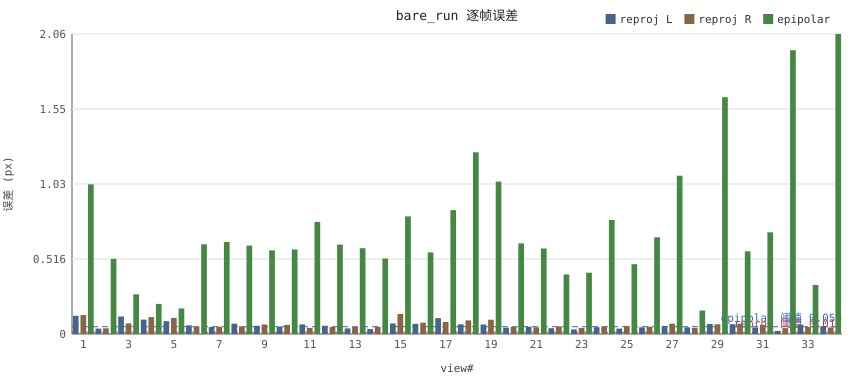
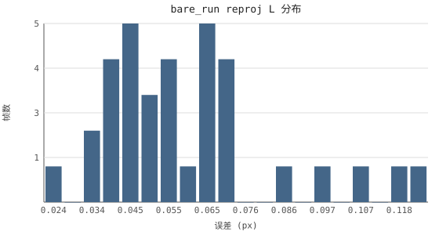

# 相机标定分析报告

- 生成时间：2026-10-05 22:08:07
- 输入：1 个

## 指标说明

### 门禁与总评

| 指标 | 通俗含义 |
|---|---|
| verdict | 全部门禁通过=PASS / 有观察项=WARN / 有未过项=FAIL |
| N/A | 该项不可测或数据缺失（如无棋盘 config 时几何类指标） |
| reproj_mean | 平均重投影误差(px)——标定参数把棋盘角点「投影回」图像与实测角点的平均偏差，越小内参越准 |
| epipolar_mean | 平均极线误差(px)——左图角点经双目位姿换算后偏离右图极线的平均距离，检验外参（双目相对位姿） |
| stereoRms | 双目整体重投影 RMS(px)，内参＋外参联合误差 |
| skipped_pct | 角点提取失败被跳过的帧占比 |
| 基线 \|T\| | 双目两相机光心的物理间距（mm），跨批应稳定 |
| table:* | 温度补偿表存在性与档数检查（应为 61 档） |

### 逐帧分布

| 指标 | 通俗含义 |
|---|---|
| reprojL / reprojR | 每帧左/右相机的重投影误差 |
| P50 / P90 | 一半 / 90% 的帧低于该值，P90 更能反映最差的那批帧 |
| std | 帧间波动，越大越不整齐 |
| 外参Δ°/Δmm | 该帧瞬时外参（由左右目位姿推出）与全局标定 R/T 的旋转差/平移差——衡量该帧与整体外参的自洽程度，混有帧级位姿噪声，非真值误差 |
| 位置九宫格 | 棋盘中心在画面所处区域（上/中/下×左/中/右）＋板心像素坐标＋离画面中心偏移；左右目分别标注 |

### 一致性

| 指标 | 通俗含义 |
|---|---|
| 焦距Δ% | 左右焦距相对差，同型号镜头应接近 |
| 主点偏离 | 光心离图像中心的像素距离，过大提示装配或拟合问题 |
| validRoi 覆盖 | 立体矫正后有效画面占比，越大越好 |

### 离群帧

| 指标 | 通俗含义 |
|---|---|
| view# | 跳帧后重排的有效帧序号（1 起），不等于原始文件编号 |
| IQR / medSigma3 / TOP5 | 三种找坏帧方法（箱线 / 3σ / 最差5帧），≥2 法命中=稳定离群 |
| 距离mm | 该帧棋盘到相机的拍摄距离 |
| 斜角° | 棋盘平面与光轴夹角，越斜越难测准 |
| 覆盖% | 棋盘占画面面积比，太小则角点像素不足 |
| L-R比 | 左右误差之比，偏离 1 表示单侧劣化 |
| 双差 | 重投影与极线误差都大=该帧本身质量差 |

### 相关性

| 指标 | 通俗含义 |
|---|---|
| corrDist / corrAngle / corrCoverInv | 误差与距离/斜角/覆盖的关系强度（-1~1），绝对值越大越相关 |
| 星号 | 显著性——* p&lt;0.05，** p&lt;0.01，. p&lt;0.10（弱证据），无星=可能只是巧合 |
| 偏相关 | 剔除干扰因素后的净关系（如去掉距离影响的纯边缘效应） |
| corrFrameIdx | 误差随拍摄顺序的趋势，强相关提示采集期漂移（如热漂） |
| 偏度/峰度 | 分布形态——偏度&gt;0 有坏帧长尾；峰度高=厚尾，极端误差帧偏多 |
| fxFyPct | 焦距纵横比差，应接近 0 |

### 标定可信度

| 指标 | 通俗含义 |
|---|---|
| 帧数≥10 | OpenCV 实践门槛，太少解不稳 |
| 姿态方向 | 棋盘至少两个朝向，单一朝向方程病态 |
| 宫格角落 | 棋盘须拍到画面边角，否则边缘畸变欠约束 |
| 参考量级 | 良好制作下典型重投影误差约 0.1px（BoofCV 经验值）；门禁阈值仍以 config 为准 |

### 双目一致性

| 指标 | 通俗含义 |
|---|---|
| L-R差值 std | 同帧左右误差差的波动，大=两相机表现不一致 |
| corrLR | 左右误差同帧相关，高=坏帧是全局的（光照/棋盘问题） |
| corrReprojEpi | 内参×外参误差相关，≈0 说明两者不同源 |
| β | 距离-误差斜率——≈-1 纯板尺寸效应 / ≈0 像素噪声主导 / &gt;0 越远越糊（对焦可疑）；robust=剔除杠杆帧后值；⚠杠杆敏感=结果受个别帧影响大 |
| 失衡帧 | 左右误差比 &gt;1.5 或 &lt;0.67 的帧 |

### 批次间投影差异

| 指标 | 通俗含义 |
|---|---|
| maxPx / meanPx | 两批参数对同一画面点投影位置的最大/平均偏差 |
| kOnlyMaxPx | 只换 K 不换畸变的偏差——分辨差异来自 K 还是畸变 |
| 一致性指示器 | 只说明「两批参数差多少」，不能区分镜头变化/拟合波动/参数漂移 |
| Δ vs 首列 | 与第一个输入批次相比的百分比变化（首列自身为 N/A） |
| 高误差 view 重现 | 两批按 view# 对齐后，同名帧在两批都超过各自 P90——重现提示系统性问题 |
| Δfx%/Δcx/Δcy/Δk1~k3/Δp1/Δp2 | 两批参数逐项增量（焦距%/主点/径向/切向畸变系数） |

### 指纹

| 指标 | 通俗含义 |
|---|---|
| R1~R8 | 八类常见问题特征判定（对焦不一致/覆盖不足/远距小板/外参嫌疑/单相机劣化/全局场景/热漂/数据病态） |
| 判定标记 | ⚠命中 / —排除 / ? 证据不足；「初步重现」=2-3 批线索级，≥4 批结论级 |

## bare_run

- 文件：`C:\Users\DUUMM\AppData\Local\Temp\opencode\bare_run\camera_calib.json`
- schema：factory_calib.camera_calib.v1
- 参考温度：22.5 °C
- 帧：input 34 / valid 34 / 跳过 0.0%
- 基线 |T|：133.24 mm
- 阈值：reproj ≤ 0.012（default），epipolar ≤ 0.05（default）
- 综合判定：**FAIL**

### 质量指标

| 指标 | 值 | 阈值 | 判定 |
|---|---|---|---|
| reproj_mean | 0.0628 | ≤ 0.012 | FAIL |
| epipolar_mean | 0.7266 | ≤ 0.05 | FAIL |
| skipped_pct | 0.0% | ≤ 10% | PASS |

### 分布（per-view）

| 序列 | n | min | P50 | P90 | max | mean | std |
|---|---|---|---|---|---|---|---|
| reproj L | 34 | 0.0211 | 0.0548 | 0.0958 | 0.1254 | 0.0603 | 0.0241 |
| reproj R | 34 | 0.0389 | 0.0521 | 0.1072 | 0.1375 | 0.0653 | 0.0259 |
| epipolar | 34 | 0.1614 | 0.6115 | 1.2015 | 2.0637 | 0.7266 | 0.4379 |

### 一致性

- 焦距：L 1839.54 px / R 1826.53 px（Δ 0.71%）
- 主点偏离中心：L 27.67 px / R 48.61 px
- validRoi 覆盖：L 44.0% / R 44.2%

### 离群帧

> view# 为跳帧后 valid 序号（1 基），≠原始帧号。

- IQR（1.5×IQR）：1, 3, 4, 15
- medSigma3（median±3σ）：N/A
- TOP5：15, 1, 3, 4, 5
- 稳定离群（≥2 法命中）：1, 3, 4, 15

| view# | reprojL | reprojR | epi | 距离mm | 斜角° | 覆盖% | L-R比 | 双差 |
|---|---|---|---|---|---|---|---|---|
| 15 | 0.0719 | 0.1375 | 0.8087 | N/A | N/A | N/A | 0.52 | 否 |
| 1 | 0.1254 | 0.1298 | 1.0288 | N/A | N/A | N/A | 0.97 | 否 |
| 3 | 0.1202 | 0.0730 | 0.2734 | N/A | N/A | N/A | 1.65 | 否 |
| 4 | 0.0990 | 0.1163 | 0.2074 | N/A | N/A | N/A | 0.85 | 否 |
| 5 | 0.0883 | 0.1110 | 0.1757 | N/A | N/A | N/A | 0.79 | 否 |

### 逐帧数据表

> 外参Δ°/Δmm＝该帧瞬时外参（由左右目位姿推出）与全局标定 R/T 的自洽性残差，非真值误差；位置＝棋盘中心九宫格(坐标px,离画面中心偏移px)；✱＝离群帧；几何列无棋盘 config 时为 N/A。

| view# | reprojL | reprojR | 外参Δ° | 外参Δmm | 极线 | 距离L/R mm | 斜角L/R° | 位置L | 位置R |
|---|---|---|---|---|---|---|---|---|---|
| ✱ 1 | 0.1254 | 0.1298 | 0.087 | 0.34 | 1.0288 | N/A | N/A | N/A | N/A |
| 2 | 0.0371 | 0.0389 | 0.106 | 0.57 | 0.5168 | N/A | N/A | N/A | N/A |
| ✱ 3 | 0.1202 | 0.0730 | 0.031 | 0.24 | 0.2734 | N/A | N/A | N/A | N/A |
| ✱ 4 | 0.0990 | 0.1163 | 0.079 | 0.93 | 0.2074 | N/A | N/A | N/A | N/A |
| 5 | 0.0883 | 0.1110 | 0.154 | 1.99 | 0.1757 | N/A | N/A | N/A | N/A |
| 6 | 0.0602 | 0.0517 | 0.067 | 0.33 | 0.6168 | N/A | N/A | N/A | N/A |
| 7 | 0.0479 | 0.0499 | 0.092 | 0.57 | 0.6328 | N/A | N/A | N/A | N/A |
| 8 | 0.0709 | 0.0520 | 0.172 | 1.40 | 0.6079 | N/A | N/A | N/A | N/A |
| 9 | 0.0562 | 0.0655 | 0.144 | 1.74 | 0.5758 | N/A | N/A | N/A | N/A |
| 10 | 0.0514 | 0.0626 | 0.142 | 2.00 | 0.5816 | N/A | N/A | N/A | N/A |
| 11 | 0.0663 | 0.0422 | 0.044 | 0.30 | 0.7714 | N/A | N/A | N/A | N/A |
| 12 | 0.0564 | 0.0479 | 0.068 | 0.63 | 0.6151 | N/A | N/A | N/A | N/A |
| 13 | 0.0383 | 0.0483 | 0.098 | 1.05 | 0.5901 | N/A | N/A | N/A | N/A |
| 14 | 0.0338 | 0.0499 | 0.112 | 1.43 | 0.5187 | N/A | N/A | N/A | N/A |
| ✱ 15 | 0.0719 | 0.1375 | 0.063 | 0.32 | 0.8087 | N/A | N/A | N/A | N/A |
| 16 | 0.0702 | 0.0776 | 0.048 | 0.29 | 0.5614 | N/A | N/A | N/A | N/A |
| 17 | 0.1090 | 0.0825 | 0.011 | 0.10 | 0.8518 | N/A | N/A | N/A | N/A |
| ✱ 18 | 0.0670 | 0.0932 | 0.044 | 0.66 | 1.2499 | N/A | N/A | N/A | N/A |
| 19 | 0.0654 | 0.0981 | 0.067 | 1.14 | 1.0484 | N/A | N/A | N/A | N/A |
| 20 | 0.0433 | 0.0497 | 0.056 | 0.34 | 0.6233 | N/A | N/A | N/A | N/A |
| 21 | 0.0504 | 0.0460 | 0.013 | 0.07 | 0.5884 | N/A | N/A | N/A | N/A |
| 22 | 0.0396 | 0.0522 | 0.053 | 0.59 | 0.4090 | N/A | N/A | N/A | N/A |
| 23 | 0.0315 | 0.0416 | 0.093 | 1.32 | 0.4217 | N/A | N/A | N/A | N/A |
| 24 | 0.0469 | 0.0499 | 0.065 | 0.38 | 0.7842 | N/A | N/A | N/A | N/A |
| 25 | 0.0372 | 0.0557 | 0.110 | 0.67 | 0.4803 | N/A | N/A | N/A | N/A |
| 26 | 0.0461 | 0.0504 | 0.074 | 0.53 | 0.6651 | N/A | N/A | N/A | N/A |
| 27 | 0.0534 | 0.0708 | 0.097 | 0.68 | 1.0886 | N/A | N/A | N/A | N/A |
| 28 | 0.0459 | 0.0419 | 0.010 | 0.21 | 0.1614 | N/A | N/A | N/A | N/A |
| ✱ 29 | 0.0689 | 0.0670 | 0.210 | 2.34 | 1.6288 | N/A | N/A | N/A | N/A |
| 30 | 0.0673 | 0.0699 | 0.383 | 4.06 | 0.5692 | N/A | N/A | N/A | N/A |
| 31 | 0.0446 | 0.0628 | 0.741 | 11.10 | 0.6992 | N/A | N/A | N/A | N/A |
| ✱ 32 | 0.0211 | 0.0407 | 0.456 | 7.20 | 1.9525 | N/A | N/A | N/A | N/A |
| 33 | 0.0651 | 0.0496 | 0.142 | 2.42 | 0.3369 | N/A | N/A | N/A | N/A |
| ✱ 34 | 0.0527 | 0.0445 | 0.184 | 2.77 | 2.0637 | N/A | N/A | N/A | N/A |

### 相关性

- corrDist（误差~距离（左目））：N/A
- corrAngle（误差~斜角（左目））：N/A
- corrCoverInv（误差~覆盖取负（左目））：N/A
- corrFrameIdx（误差~帧序(最大侧)）：-0.4159*（p=0.0144）
- corrDistPartial（误差~距离 | 控制斜角）：N/A
- corrEdgePartial（误差~斜角 | 控制距离）：N/A
- 偏度：L 1.1074 / R 1.3619 / max(L,R) 1.0860
- 峰度（超额）：L 0.8749 / R 0.9039 / max(L,R) -0.0007
- fx-fy 差：L 0.022% / R 0.029%
- 可用样本 n：34

### 标定可信度

- 帧数：N/A（no board config）
- 姿态方向多样性：N/A（no board config）
- 宫格覆盖：N/A（no board config）
- 综合判定：N/A
- 参考量级：良好制作下典型重投影误差约 0.1px（BoofCV 经验值）

### 双目一致性

- L-R 逐帧差：mean -0.0051 px / std 0.0193 px
- corrLR（L~R）：0.7036**（p=3.45e-6）
- corrReprojEpi（max(L,R)~极线误差）：-0.0564（p=0.7516）
- βL：β=-0.319 (robust -0.213) / βR：β=-0.190 (robust -0.077)
- 失衡帧（L/R 比 >1.5 或 <0.67）：左差 2 / 右差 4 / 共 6 帧（17.6%）
### 共性问题指纹（规则库 v1）

| 规则 | 判定 | 证据摘要 |
|---|---|---|
| R1 双目对焦/距离响应不一致 | — | βL=-0.319 βR=-0.190 |
| R2 姿态覆盖不足 | ? 证据不足 | 覆盖审计不可测（no board config） |
| R3 远距小板亚像素不足 | ? 证据不足 | corrDist 缺失（geo 缺失） |
| R4 外参/装配嫌疑 | ⚠命中 | epi/reproj=11.57 corrReprojEpi=-0.056 |
| R5 单相机劣化 | — | 失衡17.6% 左2/右4 |
| R6 全局场景问题 | ⚠命中 | corrLR=+0.704** |
| R7 采集期热漂 | — | corrFrameIdx=-0.416* |
| R8 数据量/姿态病态 | ? 证据不足 | 姿态多样性不可测（geo 缺失） |

阈值为一期经验值（实证 n=4 批）

### 物理检查清单（覆盖审计未过/不可测，请人工核查）

- [ ] 标定板平整度与刚性（翘曲会降低精度——BoofCV/mrcal 均强调）
- [ ] 双相机对焦与光圈一致性
- [ ] 漫射均匀光照、无眩光无硬阴影
- [ ] 棋盘格清洁无反光

