# 相机标定分析报告

- 生成时间：2026-10-05 22:16:47
- 输入：2 个

## 指标说明

### 门禁与总评

| 指标 | 通俗含义 |
|---|---|
| verdict | 全部门禁通过=PASS / 有观察项=WARN / 有未过项=FAIL |
| N/A | 该项不可测或数据缺失（如无棋盘 config 时几何类指标） |
| reproj_mean | 平均重投影误差(px)——标定参数把棋盘角点「投影回」图像与实测角点的平均偏差，越小内参越准 |
| epipolar_mean | 平均极线误差(px)——左图角点经双目位姿换算后偏离右图极线的平均距离，检验外参（双目相对位姿） |
| stereoRms | 双目整体重投影 RMS(px)，内参＋外参联合误差 |
| skipped_pct | 角点提取失败被跳过的帧占比 |
| 基线 \|T\| | 双目两相机光心的物理间距（mm），跨批应稳定 |
| table:* | 温度补偿表存在性与档数检查（应为 61 档） |

### 逐帧分布

| 指标 | 通俗含义 |
|---|---|
| reprojL / reprojR | 每帧左/右相机的重投影误差 |
| P50 / P90 | 一半 / 90% 的帧低于该值，P90 更能反映最差的那批帧 |
| std | 帧间波动，越大越不整齐 |
| 外参Δ°/Δmm | 该帧瞬时外参（由左右目位姿推出）与全局标定 R/T 的旋转差/平移差——衡量该帧与整体外参的自洽程度，混有帧级位姿噪声，非真值误差 |
| 位置九宫格 | 棋盘中心在画面所处区域（上/中/下×左/中/右）＋板心像素坐标＋离画面中心偏移；左右目分别标注 |

### 一致性

| 指标 | 通俗含义 |
|---|---|
| 焦距Δ% | 左右焦距相对差，同型号镜头应接近 |
| 主点偏离 | 光心离图像中心的像素距离，过大提示装配或拟合问题 |
| validRoi 覆盖 | 立体矫正后有效画面占比，越大越好 |

### 离群帧

| 指标 | 通俗含义 |
|---|---|
| view# | 跳帧后重排的有效帧序号（1 起），不等于原始文件编号 |
| IQR / medSigma3 / TOP5 | 三种找坏帧方法（箱线 / 3σ / 最差5帧），≥2 法命中=稳定离群 |
| 距离mm | 该帧棋盘到相机的拍摄距离 |
| 斜角° | 棋盘平面与光轴夹角，越斜越难测准 |
| 覆盖% | 棋盘占画面面积比，太小则角点像素不足 |
| L-R比 | 左右误差之比，偏离 1 表示单侧劣化 |
| 双差 | 重投影与极线误差都大=该帧本身质量差 |

### 相关性

| 指标 | 通俗含义 |
|---|---|
| corrDist / corrAngle / corrCoverInv | 误差与距离/斜角/覆盖的关系强度（-1~1），绝对值越大越相关 |
| 星号 | 显著性——* p&lt;0.05，** p&lt;0.01，. p&lt;0.10（弱证据），无星=可能只是巧合 |
| 偏相关 | 剔除干扰因素后的净关系（如去掉距离影响的纯边缘效应） |
| corrFrameIdx | 误差随拍摄顺序的趋势，强相关提示采集期漂移（如热漂） |
| 偏度/峰度 | 分布形态——偏度&gt;0 有坏帧长尾；峰度高=厚尾，极端误差帧偏多 |
| fxFyPct | 焦距纵横比差，应接近 0 |

### 标定可信度

| 指标 | 通俗含义 |
|---|---|
| 帧数≥10 | OpenCV 实践门槛，太少解不稳 |
| 姿态方向 | 棋盘至少两个朝向，单一朝向方程病态 |
| 宫格角落 | 棋盘须拍到画面边角，否则边缘畸变欠约束 |
| 参考量级 | 良好制作下典型重投影误差约 0.1px（BoofCV 经验值）；门禁阈值仍以 config 为准 |

### 双目一致性

| 指标 | 通俗含义 |
|---|---|
| L-R差值 std | 同帧左右误差差的波动，大=两相机表现不一致 |
| corrLR | 左右误差同帧相关，高=坏帧是全局的（光照/棋盘问题） |
| corrReprojEpi | 内参×外参误差相关，≈0 说明两者不同源 |
| β | 距离-误差斜率——≈-1 纯板尺寸效应 / ≈0 像素噪声主导 / &gt;0 越远越糊（对焦可疑）；robust=剔除杠杆帧后值；⚠杠杆敏感=结果受个别帧影响大 |
| 失衡帧 | 左右误差比 &gt;1.5 或 &lt;0.67 的帧 |

### 批次间投影差异

| 指标 | 通俗含义 |
|---|---|
| maxPx / meanPx | 两批参数对同一画面点投影位置的最大/平均偏差 |
| kOnlyMaxPx | 只换 K 不换畸变的偏差——分辨差异来自 K 还是畸变 |
| 一致性指示器 | 只说明「两批参数差多少」，不能区分镜头变化/拟合波动/参数漂移 |
| Δ vs 首列 | 与第一个输入批次相比的百分比变化（首列自身为 N/A） |
| 高误差 view 重现 | 两批按 view# 对齐后，同名帧在两批都超过各自 P90——重现提示系统性问题 |
| Δfx%/Δcx/Δcy/Δk1~k3/Δp1/Δp2 | 两批参数逐项增量（焦距%/主点/径向/切向畸变系数） |

### 指纹

| 指标 | 通俗含义 |
|---|---|
| R1~R8 | 八类常见问题特征判定（对焦不一致/覆盖不足/远距小板/外参嫌疑/单相机劣化/全局场景/热漂/数据病态） |
| 判定标记 | ⚠命中 / —排除 / ? 证据不足；「初步重现」=2-3 批线索级，≥4 批结论级 |

## CAMERA20DUIBIDU

- 文件：`C:\Users\DUUMM\AppData\Local\Temp\opencode\DUIBI1005-1_analysis\CAMERA20DUIBIDU\camera_calib.json`
- schema：factory_calib.camera_calib.v1
- 参考温度：22.5 °C
- 帧：input 34 / valid 34 / 跳过 0.0%
- 基线 |T|：133.24 mm
- 阈值：reproj ≤ 0.012（default），epipolar ≤ 0.05（default）
- 综合判定：**FAIL**

### 质量指标

| 指标 | 值 | 阈值 | 判定 |
|---|---|---|---|
| reproj_mean | 0.0628 | ≤ 0.012 | FAIL |
| epipolar_mean | 0.7266 | ≤ 0.05 | FAIL |
| skipped_pct | 0.0% | ≤ 10% | PASS |

### 分布（per-view）

| 序列 | n | min | P50 | P90 | max | mean | std |
|---|---|---|---|---|---|---|---|
| reproj L | 34 | 0.0211 | 0.0548 | 0.0958 | 0.1254 | 0.0603 | 0.0241 |
| reproj R | 34 | 0.0389 | 0.0521 | 0.1072 | 0.1375 | 0.0653 | 0.0259 |
| epipolar | 34 | 0.1614 | 0.6115 | 1.2015 | 2.0637 | 0.7266 | 0.4379 |

### 一致性

- 焦距：L 1839.54 px / R 1826.53 px（Δ 0.71%）
- 主点偏离中心：L 27.67 px / R 48.61 px
- validRoi 覆盖：L 44.0% / R 44.2%

### 离群帧

> view# 为跳帧后 valid 序号（1 基），≠原始帧号。

- IQR（1.5×IQR）：1, 3, 4, 15
- medSigma3（median±3σ）：N/A
- TOP5：15, 1, 3, 4, 5
- 稳定离群（≥2 法命中）：1, 3, 4, 15

| view# | reprojL | reprojR | epi | 距离mm | 斜角° | 覆盖% | L-R比 | 双差 |
|---|---|---|---|---|---|---|---|---|
| 15 | 0.0719 | 0.1375 | 0.8087 | 248.8 | 24.2 | 37.2 | 0.52 | 否 |
| 1 | 0.1254 | 0.1298 | 1.0288 | 247.6 | 1.5 | 34.4 | 0.97 | 否 |
| 3 | 0.1202 | 0.0730 | 0.2734 | 470.3 | 6.2 | 8.0 | 1.65 | 否 |
| 4 | 0.0990 | 0.1163 | 0.2074 | 617.3 | 6.4 | 4.5 | 0.85 | 否 |
| 5 | 0.0883 | 0.1110 | 0.1757 | 710.9 | 7.5 | 3.4 | 0.79 | 否 |

### 逐帧数据表

> 外参Δ°/Δmm＝该帧瞬时外参（由左右目位姿推出）与全局标定 R/T 的自洽性残差，非真值误差；位置＝棋盘中心九宫格(坐标px,离画面中心偏移px)；✱＝离群帧；几何列无棋盘 config 时为 N/A。

| view# | reprojL | reprojR | 外参Δ° | 外参Δmm | 极线 | 距离L/R mm | 斜角L/R° | 位置L | 位置R |
|---|---|---|---|---|---|---|---|---|---|
| ✱ 1 | 0.1254 | 0.1298 | 0.087 | 0.34 | 1.0288 | 248/209 | 1.5/19.3 | 下右(1827,1127,偏879px) | 下右(1406,1319,偏670px) |
| 2 | 0.0371 | 0.0389 | 0.106 | 0.57 | 0.5168 | 339/298 | 4.0/16.7 | 中右(1676,955,偏678px) | 下右(1565,1068,偏619px) |
| ✱ 3 | 0.1202 | 0.0730 | 0.031 | 0.24 | 0.2734 | 470/439 | 6.2/15.5 | 中右(1407,852,偏392px) | 中右(1496,933,偏500px) |
| ✱ 4 | 0.0990 | 0.1163 | 0.079 | 0.93 | 0.2074 | 617/589 | 6.4/15.7 | 中中(1304,801,偏282px) | 中右(1518,868,偏504px) |
| 5 | 0.0883 | 0.1110 | 0.154 | 1.99 | 0.1757 | 711/684 | 7.5/15.6 | 中中(1250,805,偏229px) | 中右(1514,870,偏501px) |
| 6 | 0.0602 | 0.0517 | 0.067 | 0.33 | 0.6168 | 303/254 | 17.2/36.2 | 中右(1911,1000,偏917px) | 下右(1707,1147,偏781px) |
| 7 | 0.0479 | 0.0499 | 0.092 | 0.57 | 0.6328 | 373/319 | 17.6/37.4 | 中右(1894,940,偏887px) | 下右(1879,1060,偏904px) |
| 8 | 0.0709 | 0.0520 | 0.172 | 1.40 | 0.6079 | 476/421 | 16.0/36.1 | 中右(1798,860,偏779px) | 中右(1955,948,偏948px) |
| 9 | 0.0562 | 0.0655 | 0.144 | 1.74 | 0.5758 | 644/592 | 21.5/41.7 | 中右(1669,829,偏648px) | 中右(1962,902,偏947px) |
| 10 | 0.0514 | 0.0626 | 0.142 | 2.00 | 0.5816 | 729/678 | 22.6/42.9 | 中右(1608,828,偏587px) | 中右(1941,898,偏927px) |
| 11 | 0.0663 | 0.0422 | 0.044 | 0.30 | 0.7714 | 453/396 | 20.6/1.6 | 中右(1798,846,偏777px) | 中右(1905,903,偏892px) |
| 12 | 0.0564 | 0.0479 | 0.068 | 0.63 | 0.6151 | 572/519 | 22.5/1.9 | 中右(1691,783,偏667px) | 中右(1921,834,偏899px) |
| 13 | 0.0383 | 0.0483 | 0.098 | 1.05 | 0.5901 | 707/657 | 28.6/7.9 | 中右(1591,807,偏568px) | 中右(1901,864,偏882px) |
| 14 | 0.0338 | 0.0499 | 0.112 | 1.43 | 0.5187 | 822/774 | 27.9/7.1 | 中右(1529,783,偏506px) | 中右(1886,837,偏865px) |
| ✱ 15 | 0.0719 | 0.1375 | 0.063 | 0.32 | 0.8087 | 249/205 | 24.2/31.5 | 下右(1942,1030,偏955px) | 下右(1479,1192,偏622px) |
| 16 | 0.0702 | 0.0776 | 0.048 | 0.29 | 0.5614 | 323/289 | 23.0/32.5 | 下右(1650,1156,偏737px) | 下右(1449,1311,偏690px) |
| 17 | 0.1090 | 0.0825 | 0.011 | 0.10 | 0.8518 | 477/447 | 25.6/36.7 | 下右(1429,1163,偏566px) | 下右(1504,1283,偏704px) |
| ✱ 18 | 0.0670 | 0.0932 | 0.044 | 0.66 | 1.2499 | 649/628 | 25.4/37.9 | 下中(1227,1230,偏504px) | 下右(1436,1333,偏699px) |
| 19 | 0.0654 | 0.0981 | 0.067 | 1.14 | 1.0484 | 813/796 | 24.3/34.7 | 下中(1113,1172,偏413px) | 下右(1402,1255,偏616px) |
| 20 | 0.0433 | 0.0497 | 0.056 | 0.34 | 0.6233 | 387/349 | 27.9/30.3 | 中右(1590,768,偏566px) | 中右(1537,824,偏516px) |
| 21 | 0.0504 | 0.0460 | 0.013 | 0.07 | 0.5884 | 512/483 | 31.7/33.8 | 中右(1383,596,偏398px) | 中右(1483,631,偏480px) |
| 22 | 0.0396 | 0.0522 | 0.053 | 0.59 | 0.4090 | 667/635 | 32.4/35.1 | 上中(1352,498,偏425px) | 中右(1573,526,偏600px) |
| 23 | 0.0315 | 0.0416 | 0.093 | 1.32 | 0.4217 | 840/815 | 31.9/32.9 | 上中(1211,464,偏357px) | 上右(1512,498,偏558px) |
| 24 | 0.0469 | 0.0499 | 0.065 | 0.38 | 0.7842 | 383/333 | 17.7/22.4 | 中右(1782,790,偏759px) | 中右(1754,846,偏734px) |
| 25 | 0.0372 | 0.0557 | 0.110 | 0.67 | 0.4803 | 358/351 | 17.2/23.6 | 中中(1176,884,偏191px) | 中中(1068,970,偏207px) |
| 26 | 0.0461 | 0.0504 | 0.074 | 0.53 | 0.6651 | 411/415 | 14.3/21.9 | 下中(975,1169,偏404px) | 下中(964,1245,偏481px) |
| 27 | 0.0534 | 0.0708 | 0.097 | 0.68 | 1.0886 | 480/423 | 9.8/15.4 | 下右(1831,1120,偏880px) | 下右(1979,1256,偏1073px) |
| 28 | 0.0459 | 0.0419 | 0.010 | 0.21 | 0.1614 | 613/627 | 9.5/19.0 | 下中(718,1058,偏422px) | 下中(925,1102,偏348px) |
| ✱ 29 | 0.0689 | 0.0670 | 0.210 | 2.34 | 1.6288 | 635/653 | 9.4/23.5 | 上左(631,506,偏473px) | 中中(858,574,偏255px) |
| 30 | 0.0673 | 0.0699 | 0.383 | 4.06 | 0.5692 | 667/616 | 12.7/15.0 | 中右(1624,536,偏644px) | 中右(1907,550,偏909px) |
| 31 | 0.0446 | 0.0628 | 0.741 | 11.10 | 0.6992 | 921/867 | 10.7/16.6 | 中右(1599,552,偏614px) | 中右(2008,570,偏1003px) |
| ✱ 32 | 0.0211 | 0.0407 | 0.456 | 7.20 | 1.9525 | 967/921 | 9.7/15.9 | 下右(1475,1089,偏554px) | 下右(1881,1187,偏954px) |
| 33 | 0.0651 | 0.0496 | 0.142 | 2.42 | 0.3369 | 936/958 | 6.6/27.3 | 下左(515,1163,偏644px) | 下中(864,1202,偏462px) |
| ✱ 34 | 0.0527 | 0.0445 | 0.184 | 2.77 | 2.0637 | 875/889 | 12.3/29.6 | 上左(652,483,偏468px) | 中中(974,550,偏224px) |

### 相关性

- corrDist（误差~距离（左目））：-0.3111.（p=0.0733）
- corrAngle（误差~斜角（左目））：-0.3687*（p=0.0319）
- corrCoverInv（误差~覆盖取负（左目））：-0.3090.（p=0.0754）
- corrFrameIdx（误差~帧序（左目））：-0.4705**（p=0.0050）
- corrDistPartial（误差~距离 | 控制斜角）：-0.3216.（p=0.0636）
- corrEdgePartial（误差~斜角 | 控制距离）：-0.3772*（p=0.0279）
- 偏度：L 1.1074 / R 1.3619 / max(L,R) 1.0860
- 峰度（超额）：L 0.8749 / R 0.9039 / max(L,R) -0.0007
- fx-fy 差：L 0.022% / R 0.029%
- 可用样本 n：34

### 标定可信度

- 帧数：34（≥10 ✓）
- 偏离首帧方向 >15° 的帧数：20（门槛 ≥1 ✓）
- 宫格帧数（3×3）：2 / 2 / 0 ｜ 0 / 3 / 16 ｜ 1 / 4 / 6
- 四角空 1 / 四边空 1（角空 ≤2 ✓）
- 综合判定：✓ 通过
- 参考量级：良好制作下典型重投影误差约 0.1px（BoofCV 经验值）

### 双目一致性

- L-R 逐帧差：mean -0.0051 px / std 0.0193 px
- corrLR（L~R）：0.7036**（p=3.45e-6）
- corrReprojEpi（max(L,R)~极线误差）：-0.0564（p=0.7516）
- βL：β=-0.319 (robust -0.213) / βR：β=-0.190 (robust -0.077)
- 失衡帧（L/R 比 >1.5 或 <0.67）：左差 2 / 右差 4 / 共 6 帧（17.6%）
### 共性问题指纹（规则库 v1）

| 规则 | 判定 | 证据摘要 |
|---|---|---|
| R1 双目对焦/距离响应不一致 | — | βL=-0.319 βR=-0.190 |
| R2 姿态覆盖不足 | — | 帧数✓ 方向✓ 宫格✓ |
| R3 远距小板亚像素不足 | — | corrDist=-0.311. βL=-0.319 |
| R4 外参/装配嫌疑 | ⚠命中 | epi/reproj=11.57 corrReprojEpi=-0.056 |
| R5 单相机劣化 | — | 失衡17.6% 左2/右4 |
| R6 全局场景问题 | ⚠命中 | corrLR=+0.704** |
| R7 采集期热漂 | — | corrFrameIdx=-0.470** |
| R8 数据量/姿态病态 | — | valid=34 方向✓ |

阈值为一期经验值（实证 n=4 批）

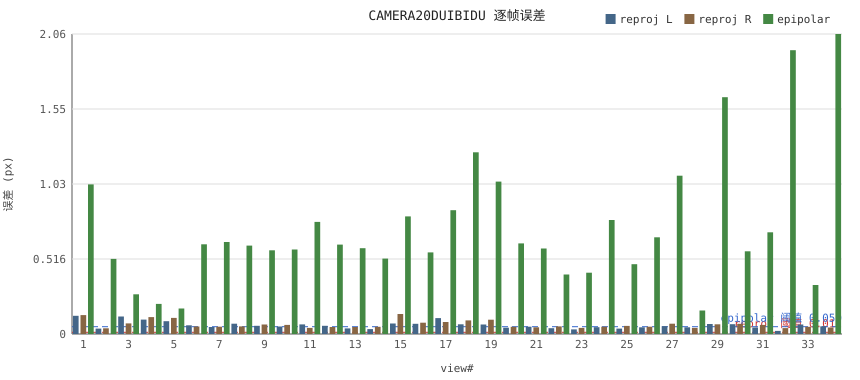
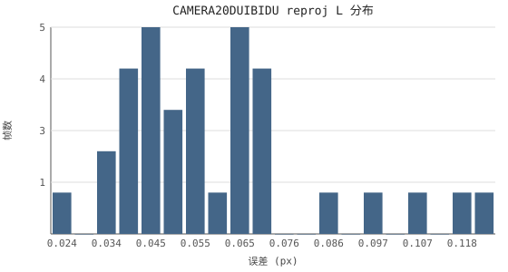
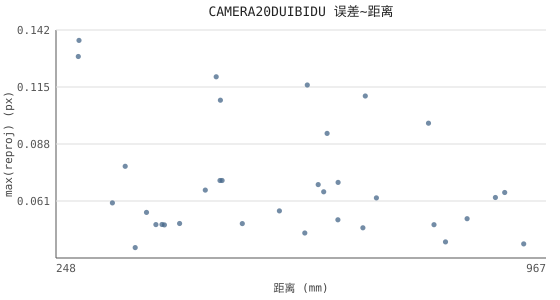
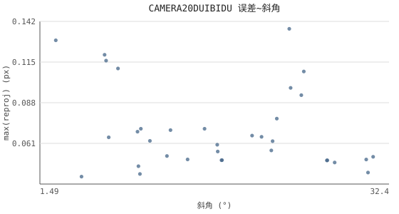
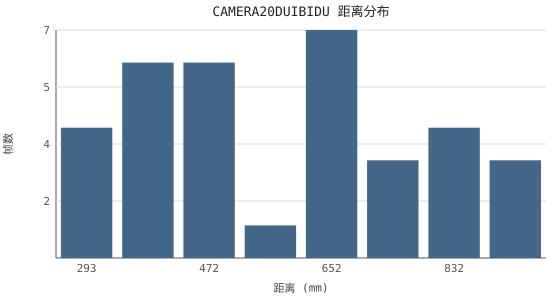
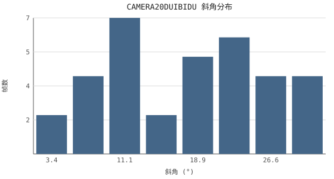

## CAMERA60DUIBIDU

- 文件：`C:\Users\DUUMM\AppData\Local\Temp\opencode\DUIBI1005-1_analysis\CAMERA60DUIBIDU\camera_calib.json`
- schema：factory_calib.camera_calib.v1
- 参考温度：22.5 °C
- 帧：input 26 / valid 26 / 跳过 0.0%
- 基线 |T|：133.12 mm
- 阈值：reproj ≤ 0.012（default），epipolar ≤ 0.05（default）
- 综合判定：**FAIL**

### 质量指标

| 指标 | 值 | 阈值 | 判定 |
|---|---|---|---|
| reproj_mean | 0.0599 | ≤ 0.012 | FAIL |
| epipolar_mean | 0.7263 | ≤ 0.05 | FAIL |
| skipped_pct | 0.0% | ≤ 10% | PASS |

### 分布（per-view）

| 序列 | n | min | P50 | P90 | max | mean | std |
|---|---|---|---|---|---|---|---|
| reproj L | 26 | 0.0299 | 0.0498 | 0.0840 | 0.1060 | 0.0565 | 0.0213 |
| reproj R | 26 | 0.0376 | 0.0540 | 0.1103 | 0.1249 | 0.0632 | 0.0270 |
| epipolar | 26 | 0.2094 | 0.6593 | 1.3312 | 2.3326 | 0.7263 | 0.5202 |

### 一致性

- 焦距：L 1840.60 px / R 1831.96 px（Δ 0.47%）
- 主点偏离中心：L 26.99 px / R 51.99 px
- validRoi 覆盖：L 44.4% / R 44.5%

### 离群帧

> view# 为跳帧后 valid 序号（1 基），≠原始帧号。

- IQR（1.5×IQR）：N/A
- medSigma3（median±3σ）：N/A
- TOP5：5, 11, 4, 13, 14
- 稳定离群（≥2 法命中）：N/A

| view# | reprojL | reprojR | epi | 距离mm | 斜角° | 覆盖% | L-R比 | 双差 |
|---|---|---|---|---|---|---|---|---|
| 5 | 0.0742 | 0.1249 | 0.2094 | 722.9 | 11.7 | 3.4 | 0.59 | 否 |
| 11 | 0.0776 | 0.1230 | 0.7645 | 248.8 | 30.2 | 36.9 | 0.63 | 否 |
| 4 | 0.0851 | 0.1153 | 0.2188 | 627.2 | 12.1 | 4.6 | 0.74 | 否 |
| 13 | 0.1060 | 0.0762 | 1.3394 | 491.1 | 24.2 | 8.7 | 1.39 | 是 |
| 14 | 0.0591 | 0.1052 | 2.1441 | 657.2 | 23.2 | 4.7 | 0.56 | 是 |

### 逐帧数据表

> 外参Δ°/Δmm＝该帧瞬时外参（由左右目位姿推出）与全局标定 R/T 的自洽性残差，非真值误差；位置＝棋盘中心九宫格(坐标px,离画面中心偏移px)；✱＝离群帧；几何列无棋盘 config 时为 N/A。

| view# | reprojL | reprojR | 外参Δ° | 外参Δmm | 极线 | 距离L/R mm | 斜角L/R° | 位置L | 位置R |
|---|---|---|---|---|---|---|---|---|---|
| 1 | 0.0438 | 0.0513 | 0.105 | 0.61 | 0.4250 | 328/298 | 6.8/16.9 | 下右(1526,1042,偏572px) | 下右(1367,1168,偏527px) |
| 2 | 0.0629 | 0.0382 | 0.078 | 0.48 | 0.3176 | 403/379 | 8.7/16.3 | 中中(1361,936,偏377px) | 下中(1353,1031,偏421px) |
| 3 | 0.0830 | 0.0739 | 0.067 | 0.66 | 0.2378 | 512/491 | 10.9/14.9 | 中中(1267,855,偏258px) | 中右(1391,932,偏402px) |
| 4 | 0.0851 | 0.1153 | 0.030 | 0.61 | 0.2188 | 627/610 | 12.1/14.1 | 中中(1168,816,偏152px) | 中右(1378,884,偏372px) |
| 5 | 0.0742 | 0.1249 | 0.149 | 1.99 | 0.2094 | 723/706 | 11.7/13.4 | 中中(1140,802,偏121px) | 中右(1401,866,偏390px) |
| 6 | 0.0402 | 0.0534 | 0.152 | 1.60 | 0.7341 | 634/581 | 12.6/33.2 | 中右(1715,849,偏696px) | 中右(2012,928,偏1001px) |
| 7 | 0.0375 | 0.0378 | 0.116 | 1.42 | 0.6828 | 723/673 | 18.0/38.6 | 中右(1640,823,偏619px) | 中右(1977,892,偏961px) |
| 8 | 0.0341 | 0.0427 | 0.093 | 1.26 | 0.6285 | 788/742 | 17.7/38.3 | 中右(1565,815,偏543px) | 中右(1918,881,偏901px) |
| 9 | 0.0341 | 0.0417 | 0.030 | 0.76 | 0.7868 | 758/711 | 35.9/15.3 | 中右(1557,852,偏539px) | 中右(1887,916,偏875px) |
| 10 | 0.0310 | 0.0376 | 0.050 | 1.11 | 0.7501 | 878/833 | 26.2/6.0 | 中右(1511,834,偏492px) | 中右(1888,896,偏873px) |
| 11 | 0.0776 | 0.1230 | 0.052 | 0.53 | 0.7645 | 249/212 | 30.2/33.1 | 下右(1842,1144,偏901px) | 下中(1349,1323,偏643px) |
| 12 | 0.1027 | 0.0669 | 0.032 | 0.25 | 0.6888 | 365/330 | 26.9/33.2 | 下右(1628,1258,偏778px) | 下右(1533,1406,偏816px) |
| ✱ 13 | 0.1060 | 0.0762 | 0.041 | 0.36 | 1.3394 | 491/458 | 24.2/29.4 | 下右(1485,1240,偏660px) | 下右(1589,1364,偏821px) |
| ✱ 14 | 0.0591 | 0.1052 | 0.087 | 0.95 | 2.1441 | 657/629 | 23.2/27.5 | 下中(1342,1261,偏586px) | 下右(1577,1370,偏817px) |
| ✱ 15 | 0.0299 | 0.0564 | 0.103 | 1.53 | 2.3326 | 867/849 | 21.1/36.0 | 下中(1167,1234,偏487px) | 下右(1481,1329,偏724px) |
| 16 | 0.0461 | 0.0580 | 0.063 | 0.47 | 0.8715 | 358/323 | 29.9/32.7 | 中右(1597,791,偏574px) | 中右(1507,880,偏496px) |
| 17 | 0.0498 | 0.0547 | 0.056 | 0.40 | 0.6922 | 393/358 | 30.2/31.2 | 中右(1561,779,偏537px) | 中右(1537,861,偏521px) |
| 18 | 0.0504 | 0.0480 | 0.032 | 0.20 | 0.6600 | 443/409 | 28.8/30.7 | 中右(1499,687,偏482px) | 中右(1557,756,偏533px) |
| 19 | 0.0497 | 0.0527 | 0.024 | 0.22 | 0.4869 | 494/464 | 28.3/30.5 | 中右(1409,637,偏407px) | 中右(1514,698,偏495px) |
| 20 | 0.0453 | 0.0576 | 0.004 | 0.32 | 0.3503 | 585/559 | 29.5/31.3 | 中中(1320,568,偏357px) | 中右(1496,613,偏497px) |
| 21 | 0.0385 | 0.0561 | 0.024 | 0.63 | 0.3832 | 673/651 | 31.5/32.0 | 上中(1225,512,偏326px) | 中右(1451,553,偏478px) |
| 22 | 0.0395 | 0.0426 | 0.028 | 0.74 | 0.3727 | 765/745 | 30.6/30.8 | 上中(1191,485,偏329px) | 中右(1463,526,偏501px) |
| 23 | 0.0662 | 0.0411 | 0.076 | 0.55 | 0.6586 | 367/364 | 15.2/23.7 | 中中(1103,786,偏81px) | 中中(1028,856,偏88px) |
| 24 | 0.0402 | 0.0418 | 0.067 | 0.65 | 0.3658 | 569/576 | 14.5/11.8 | 下中(847,1094,偏371px) | 下中(1016,1141,偏373px) |
| 25 | 0.0713 | 0.1011 | 0.106 | 1.23 | 1.3230 | 611/626 | 13.8/25.6 | 中中(719,534,偏384px) | 中中(924,598,偏197px) |
| 26 | 0.0713 | 0.0462 | 0.020 | 0.52 | 0.4596 | 640/589 | 15.1/16.6 | 中右(1657,563,偏665px) | 中右(1921,580,偏916px) |

### 相关性

- corrDist（误差~距离（左目））：-0.4718*（p=0.0150）
- corrAngle（误差~斜角（左目））：-0.2157（p=0.2900）
- corrCoverInv（误差~覆盖取负（左目））：-0.3544.（p=0.0756）
- corrFrameIdx（误差~帧序（左目））：-0.1038（p=0.6139）
- corrDistPartial（误差~距离 | 控制斜角）：-0.4767*（p=0.0138）
- corrEdgePartial（误差~斜角 | 控制距离）：-0.2285（p=0.2615）
- 偏度：L 0.7699 / R 1.1988 / max(L,R) 0.7711
- 峰度（超额）：L -0.3894 / R 0.0823 / max(L,R) -0.8578
- fx-fy 差：L 0.008% / R 0.021%
- 可用样本 n：26

### 标定可信度

- 帧数：26（≥10 ✓）
- 偏离首帧方向 >15° 的帧数：21（门槛 ≥1 ✓）
- 宫格帧数（3×3）：0 / 2 / 0 ｜ 0 / 7 / 10 ｜ 0 / 3 / 4
- 四角空 3 / 四边空 1（角空 ≤2 ✗）
- 综合判定：✗ 未过
- 参考量级：良好制作下典型重投影误差约 0.1px（BoofCV 经验值）

### 双目一致性

- L-R 逐帧差：mean -0.0067 px / std 0.0226 px
- corrLR（L~R）：0.5833**（p=0.0018）
- corrReprojEpi（max(L,R)~极线误差）：0.1467（p=0.4744）
- βL：β=-0.545 (robust -0.561) / βR：β=-0.175 (robust 0.056) ⚠杠杆敏感
- 失衡帧（L/R 比 >1.5 或 <0.67）：左差 4 / 右差 4 / 共 8 帧（30.8%）
### 共性问题指纹（规则库 v1）

| 规则 | 判定 | 证据摘要 |
|---|---|---|
| R1 双目对焦/距离响应不一致 | — | βL=-0.545 βR=-0.175 |
| R2 姿态覆盖不足 | ⚠命中 | 帧数✓ 方向✓ 宫格✗ |
| R3 远距小板亚像素不足 | — | corrDist=-0.472* βL=-0.545 |
| R4 外参/装配嫌疑 | ⚠命中 | epi/reproj=12.13 corrReprojEpi=+0.147 |
| R5 单相机劣化 | — | 失衡30.8% 左4/右4 |
| R6 全局场景问题 | ⚠命中 | corrLR=+0.583** |
| R7 采集期热漂 | — | corrFrameIdx=-0.104 |
| R8 数据量/姿态病态 | — | valid=26 方向✓ |

阈值为一期经验值（实证 n=4 批）

### 物理检查清单（覆盖审计未过/不可测，请人工核查）

- [ ] 标定板平整度与刚性（翘曲会降低精度——BoofCV/mrcal 均强调）
- [ ] 双相机对焦与光圈一致性
- [ ] 漫射均匀光照、无眩光无硬阴影
- [ ] 棋盘格清洁无反光

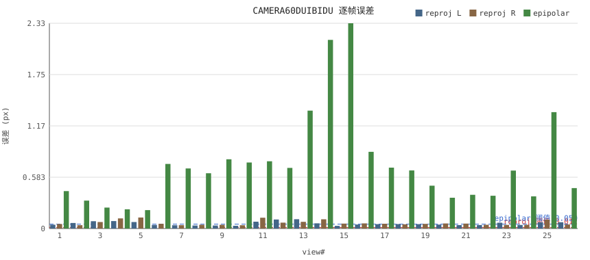
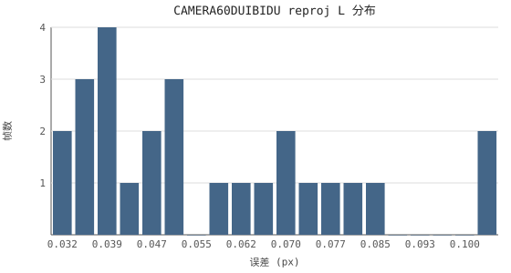
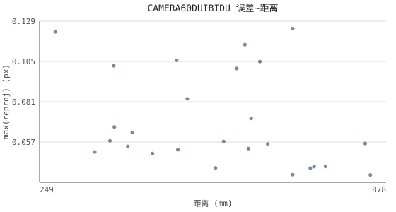
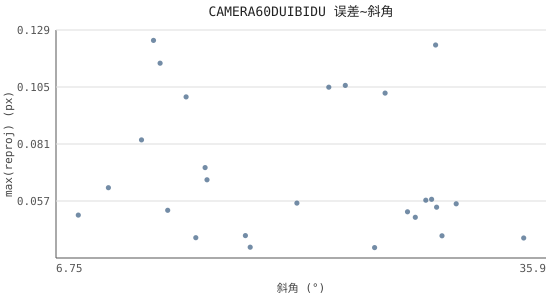
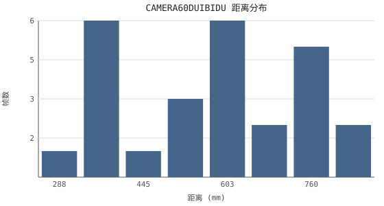
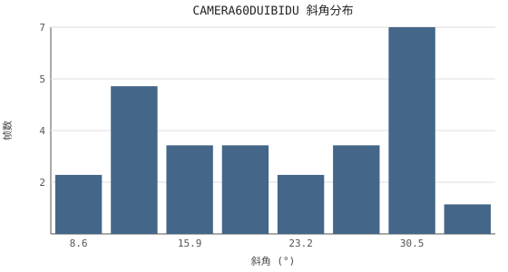

## 跨批次对比

| 指标 | CAMERA20DUIBIDU | CAMERA60DUIBIDU |
|---|---|---|
| verdict | FAIL | FAIL |
| reproj_mean (px) | 0.0628 | 0.0599 |
| Δ vs 首列 | N/A | -4.6% |
| epipolar_mean (px) | 0.7266 | 0.7263 |
| Δ vs 首列 | N/A | -0.0% |
| stereoRms (px) | 0.1409 | 0.1773 |
| Δ vs 首列 | N/A | +25.8% |
| skipped% | 0.0000 | 0.0000 |
| Δ vs 首列 | N/A | N/A |
| baseline (mm) | 133.2374 | 133.1211 |
| Δ vs 首列 | N/A | -0.1% |
| focalDiff% | 0.7100 | 0.4708 |
| Δ vs 首列 | N/A | -33.7% |
| 稳定离群 (reproj) | 1, 3, 4, 15 | N/A |

### 高误差 view 重现

> 对齐假设：两批 valid 帧按采集序对齐，view# 相同不代表同一原始帧。

- CAMERA60DUIBIDU vs CAMERA20DUIBIDU（对齐 26 帧，P90 阈值 0.1147 / 0.1107）：view# 4

### 指纹跨批重现

- R4：CAMERA20DUIBIDU、CAMERA60DUIBIDU（初步重现（线索级，≥4 批=结论级））
- R6：CAMERA20DUIBIDU、CAMERA60DUIBIDU（初步重现（线索级，≥4 批=结论级））

### 批次间投影差异（一致性指示器）

- CAMERA20DUIBIDU → CAMERA60DUIBIDU

| 目 | maxPx | meanPx | kOnlyMaxPx |
|---|---|---|---|
| 左目 | 2.53 | 0.88 | 1.23 |
| 右目 | 8.04 | 4.33 | 6.71 |

| 目 | Δfx% | Δcx px | Δcy px | Δk1 | Δk2 | Δk3 | Δp1 | Δp2 |
|---|---|---|---|---|---|---|---|---|
| 左目 | 0.051 | -0.67 | 0.09 | 0.0017 | -0.0082 | 0.0320 | -0.0001 | -0.0001 |
| 右目 | 0.272 | -4.03 | 0.25 | 0.0017 | 0.0040 | -0.0032 | -0.0001 | -0.0003 |

> 说明：该差异场无法区分镜头物理变化 / 拟合不稳定 / 参数漂移中的主导因素，仅作为跨批一致性指示器，不构成因果结论。

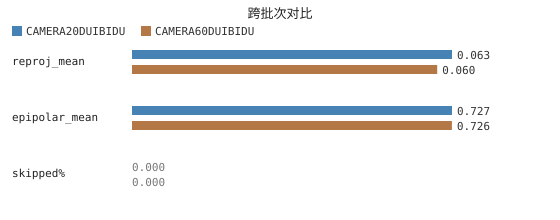

