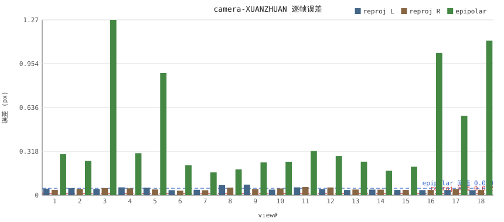
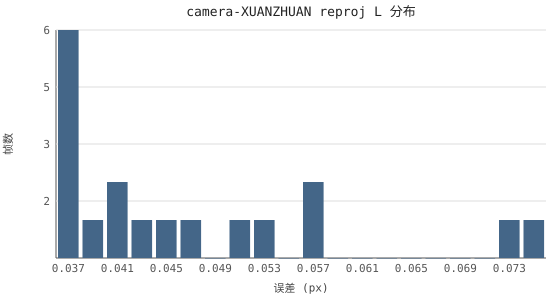
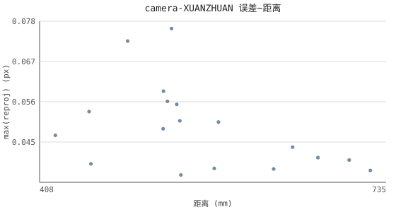
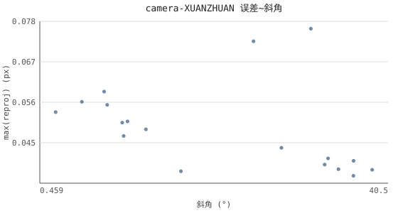
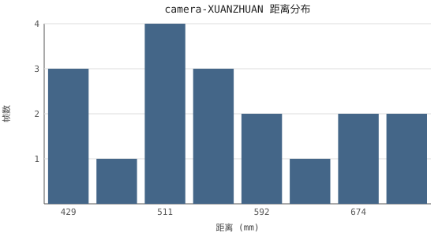
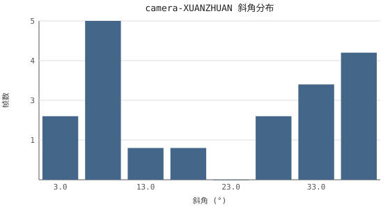

# 相机标定分析报告

- 生成时间：2026-10-05 22:32:13
- 输入：1 个

## 指标说明

### 门禁与总评

| 指标 | 通俗含义 |
|---|---|
| verdict | 全部门禁通过=PASS / 有观察项=WARN / 有未过项=FAIL |
| N/A | 该项不可测或数据缺失（如无棋盘 config 时几何类指标） |
| reproj_mean | 平均重投影误差(px)——标定参数把棋盘角点「投影回」图像与实测角点的平均偏差，越小内参越准 |
| epipolar_mean | 平均极线误差(px)——左图角点经双目位姿换算后偏离右图极线的平均距离，检验外参（双目相对位姿） |
| stereoRms | 双目整体重投影 RMS(px)，内参＋外参联合误差 |
| skipped_pct | 角点提取失败被跳过的帧占比 |
| 基线 \|T\| | 双目两相机光心的物理间距（mm），跨批应稳定 |
| table:* | 温度补偿表存在性与档数检查（应为 61 档） |

### 逐帧分布

| 指标 | 通俗含义 |
|---|---|
| reprojL / reprojR | 每帧左/右相机的重投影误差 |
| P50 / P90 | 一半 / 90% 的帧低于该值，P90 更能反映最差的那批帧 |
| std | 帧间波动，越大越不整齐 |
| 外参Δ°/Δmm | 该帧瞬时外参（由左右目位姿推出）与全局标定 R/T 的旋转差/平移差——衡量该帧与整体外参的自洽程度，混有帧级位姿噪声，非真值误差 |
| 位置九宫格 | 棋盘中心在画面所处区域（上/中/下×左/中/右）＋板心像素坐标＋离画面中心偏移；左右目分别标注 |

### 一致性

| 指标 | 通俗含义 |
|---|---|
| 焦距Δ% | 左右焦距相对差，同型号镜头应接近 |
| 主点偏离 | 光心离图像中心的像素距离，过大提示装配或拟合问题 |
| validRoi 覆盖 | 立体矫正后有效画面占比，越大越好 |

### 离群帧

| 指标 | 通俗含义 |
|---|---|
| view# | 跳帧后重排的有效帧序号（1 起），不等于原始文件编号 |
| IQR / medSigma3 / TOP5 | 三种找坏帧方法（箱线 / 3σ / 最差5帧），≥2 法命中=稳定离群 |
| 距离mm | 该帧棋盘到相机的拍摄距离 |
| 斜角° | 棋盘平面与光轴夹角，越斜越难测准 |
| 覆盖% | 棋盘占画面面积比，太小则角点像素不足 |
| L-R比 | 左右误差之比，偏离 1 表示单侧劣化 |
| 双差 | 重投影与极线误差都大=该帧本身质量差 |

### 相关性

| 指标 | 通俗含义 |
|---|---|
| corrDist / corrAngle / corrCoverInv | 误差与距离/斜角/覆盖的关系强度（-1~1），绝对值越大越相关 |
| 星号 | 显著性——* p&lt;0.05，** p&lt;0.01，. p&lt;0.10（弱证据），无星=可能只是巧合 |
| 偏相关 | 剔除干扰因素后的净关系（如去掉距离影响的纯边缘效应） |
| corrFrameIdx | 误差随拍摄顺序的趋势，强相关提示采集期漂移（如热漂） |
| 偏度/峰度 | 分布形态——偏度&gt;0 有坏帧长尾；峰度高=厚尾，极端误差帧偏多 |
| fxFyPct | 焦距纵横比差，应接近 0 |

### 标定可信度

| 指标 | 通俗含义 |
|---|---|
| 帧数≥10 | OpenCV 实践门槛，太少解不稳 |
| 姿态方向 | 棋盘至少两个朝向，单一朝向方程病态 |
| 宫格角落 | 棋盘须拍到画面边角，否则边缘畸变欠约束 |
| 参考量级 | 良好制作下典型重投影误差约 0.1px（BoofCV 经验值）；门禁阈值仍以 config 为准 |

### 双目一致性

| 指标 | 通俗含义 |
|---|---|
| L-R差值 std | 同帧左右误差差的波动，大=两相机表现不一致 |
| corrLR | 左右误差同帧相关，高=坏帧是全局的（光照/棋盘问题） |
| corrReprojEpi | 内参×外参误差相关，≈0 说明两者不同源 |
| β | 距离-误差斜率——≈-1 纯板尺寸效应 / ≈0 像素噪声主导 / &gt;0 越远越糊（对焦可疑）；robust=剔除杠杆帧后值；⚠杠杆敏感=结果受个别帧影响大 |
| 失衡帧 | 左右误差比 &gt;1.5 或 &lt;0.67 的帧 |

### 批次间投影差异

| 指标 | 通俗含义 |
|---|---|
| maxPx / meanPx | 两批参数对同一画面点投影位置的最大/平均偏差 |
| kOnlyMaxPx | 只换 K 不换畸变的偏差——分辨差异来自 K 还是畸变 |
| 一致性指示器 | 只说明「两批参数差多少」，不能区分镜头变化/拟合波动/参数漂移 |
| Δ vs 首列 | 与第一个输入批次相比的百分比变化（首列自身为 N/A） |
| 高误差 view 重现 | 两批按 view# 对齐后，同名帧在两批都超过各自 P90——重现提示系统性问题 |
| Δfx%/Δcx/Δcy/Δk1~k3/Δp1/Δp2 | 两批参数逐项增量（焦距%/主点/径向/切向畸变系数） |

### 指纹

| 指标 | 通俗含义 |
|---|---|
| R1~R8 | 八类常见问题特征判定（对焦不一致/覆盖不足/远距小板/外参嫌疑/单相机劣化/全局场景/热漂/数据病态） |
| 判定标记 | ⚠命中 / —排除 / ? 证据不足；「初步重现」=2-3 批线索级，≥4 批结论级 |

## camera-XUANZHUAN

- 文件：`C:\Users\DUUMM\AppData\Local\Temp\opencode\XUANZHUAN_analysis\camera-XUANZHUAN\camera_calib.json`
- schema：factory_calib.camera_calib.v1
- 参考温度：22.5 °C
- 帧：input 18 / valid 18 / 跳过 0.0%
- 基线 |T|：133.59 mm
- 阈值：reproj ≤ 0.012（default），epipolar ≤ 0.05（default）
- 综合判定：**FAIL**

### 质量指标

| 指标 | 值 | 阈值 | 判定 |
|---|---|---|---|
| reproj_mean | 0.0453 | ≤ 0.012 | FAIL |
| epipolar_mean | 0.4453 | ≤ 0.05 | FAIL |
| skipped_pct | 0.0% | ≤ 10% | PASS |

### 分布（per-view）

| 序列 | n | min | P50 | P90 | max | mean | std |
|---|---|---|---|---|---|---|---|
| reproj L | 18 | 0.0360 | 0.0417 | 0.0614 | 0.0764 | 0.0467 | 0.0120 |
| reproj R | 18 | 0.0321 | 0.0418 | 0.0543 | 0.0592 | 0.0439 | 0.0073 |
| epipolar | 18 | 0.1650 | 0.2662 | 1.0583 | 1.2723 | 0.4453 | 0.3551 |

### 一致性

- 焦距：L 1839.17 px / R 1827.49 px（Δ 0.64%）
- 主点偏离中心：L 26.93 px / R 47.80 px
- validRoi 覆盖：L 44.5% / R 44.4%

### 离群帧

> view# 为跳帧后 valid 序号（1 基），≠原始帧号。

- IQR（1.5×IQR）：N/A
- medSigma3（median±3σ）：N/A
- TOP5：9, 8, 11, 4, 12
- 稳定离群（≥2 法命中）：N/A

| view# | reprojL | reprojR | epi | 距离mm | 斜角° | 覆盖% | L-R比 | 双差 |
|---|---|---|---|---|---|---|---|---|
| 9 | 0.0764 | 0.0423 | 0.2373 | 529.0 | 32.8 | 5.4 | 1.81 | 否 |
| 8 | 0.0730 | 0.0537 | 0.1868 | 483.5 | 25.5 | 7.3 | 1.36 | 否 |
| 11 | 0.0565 | 0.0592 | 0.3212 | 520.6 | 6.6 | 8.3 | 0.95 | 否 |
| 4 | 0.0564 | 0.0496 | 0.3039 | 524.8 | 3.8 | 6.8 | 1.14 | 否 |
| 12 | 0.0430 | 0.0555 | 0.2838 | 534.4 | 7.0 | 12.4 | 0.77 | 否 |

### 逐帧数据表

> 外参Δ°/Δmm＝该帧瞬时外参（由左右目位姿推出）与全局标定 R/T 的自洽性残差，非真值误差；位置＝棋盘中心九宫格(坐标px,离画面中心偏移px)；✱＝离群帧；几何列无棋盘 config 时为 N/A。

| view# | reprojL | reprojR | 外参Δ° | 外参Δmm | 极线 | 距离L/R mm | 斜角L/R° | 位置L | 位置R |
|---|---|---|---|---|---|---|---|---|---|
| 1 | 0.0470 | 0.0386 | 0.093 | 0.61 | 0.2972 | 408/380 | 9.1/12.5 | 中右(1411,909,偏412px) | 中右(1411,1002,偏452px) |
| 2 | 0.0507 | 0.0444 | 0.061 | 0.48 | 0.2485 | 578/560 | 8.9/13.6 | 中中(1182,838,偏173px) | 中中(1355,908,偏359px) |
| ✱ 3 | 0.0441 | 0.0510 | 0.142 | 1.17 | 1.2723 | 538/492 | 9.6/11.8 | 下右(1630,1175,偏730px) | 下右(1814,1289,偏946px) |
| 4 | 0.0564 | 0.0496 | 0.146 | 1.31 | 0.3039 | 525/535 | 3.8/17.4 | 下中(824,1201,偏477px) | 下中(950,1262,偏499px) |
| 5 | 0.0535 | 0.0413 | 0.110 | 0.91 | 0.8864 | 444/463 | 0.5/20.0 | 中中(716,728,偏311px) | 中中(786,804,偏241px) |
| 6 | 0.0360 | 0.0321 | 0.039 | 0.32 | 0.2162 | 539/525 | 38.1/18.0 | 中中(1124,844,偏126px) | 中中(1261,897,偏270px) |
| 7 | 0.0391 | 0.0356 | 0.043 | 0.36 | 0.1650 | 445/420 | 34.5/54.7 | 中右(1383,863,偏372px) | 中右(1429,940,偏440px) |
| 8 | 0.0730 | 0.0537 | 0.024 | 0.21 | 0.1868 | 484/467 | 25.5/28.9 | 中中(1215,869,偏216px) | 中中(1293,932,偏315px) |
| 9 | 0.0764 | 0.0423 | 0.053 | 0.46 | 0.2373 | 529/516 | 32.8/33.0 | 中中(1141,814,偏125px) | 中中(1250,870,偏248px) |
| 10 | 0.0405 | 0.0488 | 0.055 | 0.50 | 0.2422 | 520/492 | 11.9/14.1 | 上中(1347,444,偏457px) | 上右(1473,485,偏531px) |
| 11 | 0.0565 | 0.0592 | 0.046 | 0.43 | 0.3212 | 521/503 | 6.6/17.3 | 上中(1207,270,偏530px) | 上中(1309,305,偏544px) |
| 12 | 0.0430 | 0.0555 | 0.016 | 0.19 | 0.2838 | 534/535 | 7.0/25.0 | 上中(944,273,偏501px) | 上中(1072,350,偏420px) |
| 13 | 0.0372 | 0.0408 | 0.047 | 0.53 | 0.2427 | 681/634 | 34.9/23.3 | 中右(1567,552,偏585px) | 中右(1846,573,偏845px) |
| 14 | 0.0402 | 0.0399 | 0.022 | 0.26 | 0.1774 | 713/735 | 38.2/18.8 | 下左(561,1181,偏621px) | 下中(827,1219,偏493px) |
| 15 | 0.0376 | 0.0377 | 0.038 | 0.45 | 0.2063 | 635/598 | 40.5/26.3 | 中右(1422,683,偏407px) | 中右(1652,725,偏629px) |
| ✱ 16 | 0.0366 | 0.0379 | 0.045 | 0.55 | 1.0313 | 573/581 | 36.2/27.2 | 中中(816,617,偏257px) | 中中(973,673,偏108px) |
| 17 | 0.0374 | 0.0437 | 0.047 | 0.61 | 0.5755 | 655/601 | 29.0/9.6 | 中右(1681,522,偏702px) | 中右(1963,536,偏967px) |
| ✱ 18 | 0.0360 | 0.0373 | 0.013 | 0.27 | 1.1213 | 735/706 | 16.3/23.8 | 下中(1312,1096,偏436px) | 下右(1595,1188,偏709px) |

### 相关性

- corrDist（误差~距离（左目））：-0.4459.（p=0.0636）
- corrAngle（误差~斜角（左目））：-0.2609（p=0.2958）
- corrCoverInv（误差~覆盖取负（左目））：-0.0134（p=0.9579）
- corrFrameIdx（误差~帧序（左目））：-0.3888（p=0.1108）
- corrDistPartial（误差~距离 | 控制斜角）：-0.3839（p=0.1158）
- corrEdgePartial（误差~斜角 | 控制距离）：-0.0903（p=0.7216）
- 偏度：L 1.2831 / R 0.5193 / max(L,R) 0.9643
- 峰度（超额）：L 0.6376 / R -0.7204 / max(L,R) 0.1635
- fx-fy 差：L 0.003% / R 0.023%
- 可用样本 n：18

### 标定可信度

- 帧数：18（≥10 ✓）
- 偏离首帧方向 >15° 的帧数：11（门槛 ≥1 ✓）
- 宫格帧数（3×3）：0 / 3 / 0 ｜ 0 / 6 / 5 ｜ 1 / 2 / 1
- 四角空 2 / 四边空 1（角空 ≤2 ✓）
- 综合判定：✓ 通过
- 参考量级：良好制作下典型重投影误差约 0.1px（BoofCV 经验值）

### 双目一致性

- L-R 逐帧差：mean 0.0029 px / std 0.0107 px
- corrLR（L~R）：0.4694*（p=0.0494）
- corrReprojEpi（max(L,R)~极线误差）：-0.1940（p=0.4406）
- βL：β=-0.676 (robust -0.824) / βR：β=-0.154 (robust -0.324) ⚠杠杆敏感
- 失衡帧（L/R 比 >1.5 或 <0.67）：左差 1 / 右差 0 / 共 1 帧（5.6%）
### 共性问题指纹（规则库 v1）

| 规则 | 判定 | 证据摘要 |
|---|---|---|
| R1 双目对焦/距离响应不一致 | — | βL=-0.676 βR=-0.154 |
| R2 姿态覆盖不足 | — | 帧数✓ 方向✓ 宫格✓ |
| R3 远距小板亚像素不足 | — | corrDist=-0.446. βL=-0.676 |
| R4 外参/装配嫌疑 | ⚠命中 | epi/reproj=9.83 corrReprojEpi=-0.194 |
| R5 单相机劣化 | — | 失衡5.6% 左1/右0 |
| R6 全局场景问题 | ⚠命中 | corrLR=+0.469* |
| R7 采集期热漂 | — | corrFrameIdx=-0.389 |
| R8 数据量/姿态病态 | — | valid=18 方向✓ |

阈值为一期经验值（实证 n=4 批）

